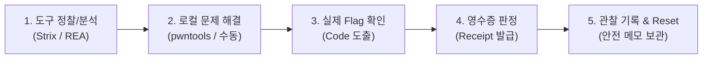

# security-lab (도구 기반 실전 CTF 및 King of the Hill 실습 환경)

> 로컬 격리 환경 기반의 도구 중심 깃발 획득(CTF) 및 King of the Hill(KoTH) 실습 랩입니다.  
> 보조 학습 플랫폼(Dreamhack, pwn.college, TryHackMe)을 연계하며, 기존 8지표 벤치마킹 체계는 완결 벤치마크 보조 기능으로 분리 유지합니다.

---

## 1. 프로젝트 개요 및 구조

`security-lab`의 주 목표는 사전에 승인된 격리 환경 내에서 보안 분석 도구(Strix, ARTEX-KO, REA, GDB/pwndbg, pwntools)를 활용하여 **실제 깃발(flag)을 획득하는 CTF 실습**과 **공격/방어 점유 경쟁을 다루는 King of the Hill(KoTH) 실습**을 수행하는 것입니다.

초기 8지표/15분/3회 벤치마크 완료나 미확정 ground-truth는 더 이상 프로젝트의 주 목적이나 깃발 실습의 선행조건이 아니며, 완결된 측정 결과를 검증하는 별도의 보조 관찰 기능으로 유지됩니다.

- **작업 경로 기준:**
  - Windows 호스트 경로: `C:\project\security-lab`
  - WSL / Linux 작업 경로: `/mnt/c/project/security-lab`
  - 현재 배정 checkout (문서): `/mnt/c/project/security-lab/.worktrees/docs` (branch: `parallel/docs`)

### 디렉터리 역할

```text
security-lab/
├── infra/                 # 격리 인프라 정의 (compose.targets.yml: Juice Shop v17.1.1, targets-net)
├── targets/               # 실습 대상 환경 안내 (targets/README.md, opencode 소유)
├── tools/                 # 보안 도구 실행 래퍼 및 안내
│   ├── strix/             # Strix 웹 탐색/검증 래퍼 (dry-run 상태, metrics.py)
│   ├── rea/               # REA 리버싱/MCP 근거 분석 도구 안내 (morluto/rea, 미설치/미연동)
│   └── artex-ko/          # ARTEX-KO 자율 공격 경로/방어 관찰 도구 안내 (jiwoochris/artex-ko, 미설치/미연동)
├── pwn/                   # 로컬 바이너리 실습 환경 (Ubuntu 24.04, GDB, pwndbg, pwntools)
│   ├── Dockerfile         # pwndbg commit 고정(2026.09.15, 55596aa6) 환경 정의 (빌드 미실행)
│   ├── challenges/        # flag-bearing 바이너리 및 Phoenix Stack Zero 기초 보조 문제 안내
│   └── exploits/          # 안전한 관찰 메모 템플릿 (플래그/페이로드 보관 금지)
├── benchmarks/            # 완결 벤치마크 보조 기능 (game 기록과 분리)
│   ├── metrics.schema.json # 8지표 측정 JSON 스키마 (15분, 반복1..3, UTC 등 강제)
│   ├── metrics.form.md    # 8지표 벤치마크 수기 기록 양식
│   └── ground-truth/      # 버전별 정답지 스텁 (findings: [], 단계 C 차단 유지)
├── logs/                  # CTF·KoTH Markdown 관찰 메모 및 완결 벤치마크 JSONL
└── reports/               # 설계서, 비교표 템플릿(comparison.template.md), 통합 검토 보고서
```

---

## 2. 도구별 역할 및 공식 출처

각 도구는 고유한 분석 및 검증 역할을 가지며, 도구의 실행 결과 자체가 플래그 획득이나 점유의 증거가 되지 않습니다 (독립 판정 필수):

1. **Strix (승인된 로컬 웹 탐색/검증):**
   - 역할: 사전에 승인된 로컬 웹 환경의 공격 표면 탐색 및 취약점 검증 보조.
   - 상태: 원본에는 구형 입력 검사/dry-run 설계만 남아 있으며, `-StrixArgs` 미지정 시 코드 7로 거부되는 결함을 확인했습니다. 별도 `strix-runtime` worktree의 수정은 안전 체크포인트에서 중지된 미통합·미검증 상태입니다. 아직 실습용 실행 진입점으로 사용하지 않습니다.
2. **ARTEX-KO (승인된 자율 공격 경로 및 방어/탐지 관찰):**
   - 공식 저장소: https://github.com/jiwoochris/artex-ko (Go backend + Next.js, AGPL-3.0 License)
   - 역할: 서면 허가된 로컬 lab 내에서 자율 공격 경로를 실습하고, 방어자 관점의 탐지 및 패치 효과를 관찰.
   - 상태: 미설치 및 미연동. 외부 공용 사이트(TryHackMe 등) 대상 자동화 공격 엄격 금지.
3. **REA (바이너리 리버싱 및 MCP 기반 근거 분석):**
   - 공식 저장소: https://github.com/morluto/rea (Reverse Engineer Anything, MCP, MIT License)
   - 역할: 바이너리 디스어셈블리, 함수 구조 분석 및 MCP 인터페이스 기반의 취약점 분석 근거 마련.
   - 상태: 미설치 및 미연동 (후속 승인 작업에서 버전 핀/툴체인 연동 검토).
4. **GDB + pwndbg (메모리 및 실행 흐름 실시간 관찰):**
   - 역할: 로컬 컨테이너 환경에서 바이너리 실행 중 레지스터, 스택/힙 메모리 레이아웃 및 제어 흐름 관찰.
   - 상태: Dockerfile 정적 고정 완료 (pwndbg 2026.09.15 immutable release commit `55596aa676a2756efb8d67034f31675170eabe48`), 컨테이너 빌드 및 VM 실행은 미실행.
5. **pwntools (승인된 로컬 챌린지 입출력 상호작용):**
   - 역할: 승인된 로컬 챌린지 프로세스와의 입출력 제어 및 재현 절차 보조 (`pwntools==4.14.0`).

---

## 3. 주 실습 흐름

### 1) CTF (Capture The Flag) 실습 흐름



- **웹 타겟 (OWASP Juice Shop v17.1.1):**
  - **현재 구성 사실:** 현재 `infra/compose.targets.yml`은 기본 Juice Shop 구성이며, `NODE_ENV=ctf` 및 event별 private `CTF_KEY`가 포함되어 있지 않습니다.
  - **후속 구성 과제:** 단일 참가자 원칙(single-user instance)에 맞춰 `NODE_ENV=ctf`, private event key, 알림 플래그 표시(`ctf.showFlagsInNotifications=true`, `config/ctf.yml`) 설정을 적용하는 후속 작업이 배정되어야 합니다 (참조: https://pwning.owasp-juice.shop/companion-guide/latest/part4/ctf.html).
  - **판정 기준:** 도구가 정찰을 수행했다는 사실만으로 성공을 주장할 수 없으며, 실제 flag code 획득 및 로컬 validator/플랫폼 수동 제출 receipt 확인을 통해 판정합니다. 현재 자동 scoreboard/judge/reset 기능은 미구현입니다.
- **바이너리 타겟:**
  - 다운로드 및 로컬 컨테이너 재현이 허용된 flag-bearing 문제를 활용하며 실제 flag/validator로 판정합니다.
  - Phoenix Stack Zero(`https://exploit.education/phoenix/stack-zero/`)는 기초 메모리 버퍼 오버플로우 관찰을 위한 보조 문제이며, 성공 메시지는 실제 CTF flag가 아닙니다 (임의 플래그 획득 주장 금지).

### 2) KoTH (King of the Hill) 실습 흐름

- **Hill 타겟 환경:**
  - 소유 및 서면 허가된 별도의 재설정 가능(snapshot reset 가능) VM을 hill target으로 사용합니다.
  - Juice Shop은 공식 가이드에서 명시된 1인용(single-user) 애플리케이션이므로 다중 참가자가 공유하는 hill로 직접 사용하지 않습니다.
- **운영 및 역할 격리:**
  - 초기에는 1인의 운영자가 공격/방어 역할을 교대로 실습하며, 이후 로컬 2팀/도구 프로필로 확장합니다.
  - 개발 worktree나 에이전트 이름은 보안 격리나 참가자 권한 수단이 아니며, 실제 참가는 VM/격리 네트워크 단위로 분리합니다.
- **점유 및 재점유 판정:**
  - **점유 조건:** Hill 타겟의 보호된 king marker에 승인된 participant ID를 기록할 권한을 획득하고, 외부 판정기가 이를 직접 읽어 확인했을 때 점유로 인정합니다. 모델의 성공 주장이나 score API에 대한 임의 POST 요청은 점유로 인정하지 않습니다.
  - **재점유:** 상대 역할이 marker를 변경하고 외부 판정기가 확인한 전환(transition)만을 인정합니다.
- **외부 Judge 분리 원칙:**
  - 판정기(judge), 경기 시계(clock), 점수 집계(score DB), VM 리셋 권한은 contest VM 밖의 보호된 관리 영역에 격리합니다.
  - 타겟 머신을 탈취하더라도 판정 인프라의 권한을 얻을 수 없도록 엄격히 분리하며, 참가자는 타겟 머신 외의 판정기, 관리망, 다른 참가자 기기를 공격할 수 없습니다.
- **라운드 및 Tick 검증:**
  - 기본 로컬 훈련 라운드는 **15분**입니다 (기존 scanner attempt 최대 900초와 완전히 별개의 게임 라운드 개념).
  - 외부 judge가 주기적으로(예: 5초마다) 유효 participant marker와 필수 서비스 생존 상태를 확인하며, 검증된 tick만 점수에 반영합니다.
- **단계 및 금지 행위:**
  - 순서: 준비/허가 확인 → 접근 획득 → marker 점유 확인 → 방어/패치 유지 → 상대 재점유 시도 → 종료 집계 → snapshot reset.
  - 금지 행위: 외부 지속성 설치, 계정 탈취, 시스템 파괴, DoS, 판정기 통신 전면 차단, flag/판정기 변조.
  - 실제 KoTH 인프라 구현 및 실행은 후속 승인 작업이며, 가상의 CLI나 임시 스캐폴드를 만들지 않습니다.

---

## 4. 보조 실습 플랫폼 및 준수 규정

공식 플랫폼은 문제 선택, 기초 학습, 힌트 및 규칙 참고를 보조하며, 플랫폼 자체나 공용 인프라에 대한 공격은 절대 금지됩니다:

1. **Dreamhack Wargame (https://dreamhack.io/wargame/):**
   - 웹, pwnable, reversing 교육 문제 학습 및 허용된 문제의 수동 실습/바이너리 다운로드 보조.
2. **pwn.college (https://pwn.college/):**
   - 시스템/바이너리 실습 환경.
   - **공식 규칙 준수:** 문제 해설, writeup, 솔루션 영상의 인터넷 공개 금지 요청에 따라, 저장소에 문제별 정답, 플래그, 공개 풀이를 절대 커밋하지 않습니다.
3. **TryHackMe King of the Hill (https://help.tryhackme.com/en/articles/6498315-king-of-the-hill-overview):**
   - KoTH 게임 규칙 및 수동 실습 참고.
   - **Rule 7 엄격 준수:** 자동 hacking/hardening scripts 사용이 금지되어 있으므로 Strix나 ARTEX-KO를 공용 THM KoTH의 자동화 도구로 안내하거나 사용하지 않습니다.
   - 공식 60분 경기 및 분당 점수 체계는 로컬 15분 라운드 훈련과 별개입니다.
4. **공통 네트워크 경계:**
   - 어떤 외부 플랫폼 링크도 `tools/strix/targets.allow`에 추가하지 않습니다.
   - 로컬 allowlist 3개(`juice-shop:3000`, `127.0.0.1:3000`, `localhost:3000`), `targets-net` (`internal: true`), 호스트 loopback 바인딩은 변경 없이 유지됩니다.

---

## 5. 기록 및 보관 정책 (엄격 준수)

- **비밀 정보 보관 절대 금지:**
  - 실제 획득한 플래그 문자열, `CTF_KEY`, API 키, 패스워드는 저장소, Git 커밋, 공개 문서에 절대 기록하지 않습니다.
  - 완성된 공격 코드, 쉘코드, 문제별 공개 풀이(writeup) 원본을 저장하지 않습니다.
  - 원시 도구 출력(stdout/stderr 무차별 덤프)을 복사하지 않습니다.
- **안전한 관찰 기록 (Markdown 관찰 메모):**
  - challenge/round 식별자, 도구 및 버전, 수행 단계.
  - 판정 receipt (플래그 본문 제외 영수증 식별자).
  - 검증된 점유 tick 및 전환 시각, 필수 서비스 생존 여부, 방어 패치 요약, 한계, snapshot reset 근거.
- **완결 벤치마크 보조 기능 (JSONL Append-Only):**
  - 8지표가 온전히 확정된 단일 측정 결과만 `benchmarks/metrics.schema.json` 규격으로 `logs/` JSONL에 저장합니다.
  - 확정된 CLI: `python3 tools/strix/metrics.py --record <완결 JSON 파일> --output <JSONL 파일>` (종료 코드 0: 성공, 2: 거부).
  - 의존성: `tools/strix/requirements.txt` (`jsonschema==4.19.2`), POSIX `flock` (Linux/WSL).
  - 스키마 강제: 필수 8개 항목(`time_limit_min: 15`, `repeat_index: 1~3`, RFC 3339 UTC, allowlist 3개, 고정 버전).
  - CTF/KoTH 게임 기록은 이 벤치마크 schema에 넣지 않으며 가상의 game writer CLI를 가장하지 않습니다.

---

## 6. 현재 상태 및 사실 기반 명시

1. **도구 및 래퍼 구현 상태:**
   - **Strix:** 기술 구현은 안전 체크포인트에서 중지됐습니다. 별도 worktree의 두 파일 수정은 원본 미통합·미검증이며 임시 경로 소유권과 sidecar 오류 정합 등이 남았습니다. 원본의 구형 입력 검사에도 추가 인자 미지정 거부 결함이 있으므로 준비된 실습 실행기로 표시하지 않습니다.
   - **REA / ARTEX-KO:** 공식 링크 확인 완료, 현재 로컬 환경에 미설치 및 미연동 상태입니다.
   - **GDB/pwndbg/pwntools:** `pwn/Dockerfile` 정적 고정 완료(pwndbg commit `55596aa676a2756efb8d67034f31675170eabe48`), 컨테이너 빌드 및 VM 실행은 미실행입니다.
2. **실습 및 인프라 상태:**
   - 실제 Docker/도구/VM 실습, CTF 플래그 제출, KoTH 인프라 기동은 **모두 미실행** 상태입니다.
   - Juice Shop CTF 모드 구성(`NODE_ENV=ctf`, private `CTF_KEY`) 및 별도 Hill VM 배치는 후속 승인 작업으로 남아 있습니다.
   - 8지표 벤치마크 실측 비교(단계 C)는 ground-truth 스텁(`findings: []`) 상태로 인해 차단 유지되나, 이는 CTF/KoTH 실습의 차단 조건이나 선행조건이 아닙니다.
3. **운영 정책:**
   - 고정 역할이 아닌 작업 단위 소유권 분담을 유지합니다.
   - OpenCode 외부 검색 제공자를 사용하지 않는 사용자 결정을 유지하며, 도입 근거는 공식 URL 직접 확인으로 정리합니다. 전역 검색 설정을 변경했다고 주장하지 않습니다.
   - 가상의 기술 옵션, 임시 placeholder, fake game CLI를 창작하지 않았습니다.
